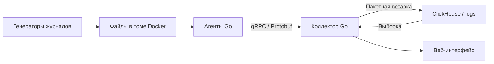

# Распределённый парсер BigData

Учебный стенд на Go для сбора, разбора и просмотра журналов. Исходники и запуск рассчитаны на Linux и Docker Compose.

## Первый прогон

На Linux откройте терминал в каталоге проекта. Для первой сборки Docker понадобится доступ к реестру образов и репозиториям зависимостей.

```bash
bash scripts/experiment.sh 1 100 10
```

Сценарий создаёт тестовый файл, ждёт готовности агента, записывает 1 000 новых строк и сверяет итог с ClickHouse. Успех означает, что для этого прогона в таблице ровно 1 000 строк и 1 000 уникальных сообщений. Сценарий печатает ссылку на веб-интерфейс с фильтром текущего прогона. Итог проверки печатается в терминале. Общий журнал открывается на [localhost:8080](http://localhost:8080/).

Проект запускает собственный ClickHouse с таблицей из пояснительной записки. Данные находятся в отдельном томе Docker, а соединение с ClickHouse доступно в сети Compose. Для остановки с сохранением данных выполните `docker compose --profile lab --profile source down`.

## Запуск на Windows

1. Установите Ubuntu в WSL 2 и запустите Docker Desktop с движком WSL 2 в режиме Linux-контейнеров.
2. В Docker Desktop откройте **Settings → Resources → WSL Integration**, включите интеграцию для Ubuntu и примените настройки.
3. Откройте терминал **Ubuntu** из меню «Пуск». Проверьте связь с Docker командой `docker info`, затем скачайте и запустите проект.

   ```bash
   git clone https://github.com/giviha/BigDataParser.git
   cd BigDataParser
   bash scripts/experiment.sh 1 100 10
   ```

   Если проект уже скачан, достаточно открыть его каталог в Ubuntu и выполнить последнюю команду. Go собирается внутри Docker.

4. После запуска откройте [веб-журнал](http://localhost:8080/) в браузере Windows. Скрипт выведет в терминал результат проверки 1 000 событий и ссылку на записи этого прогона.
5. После демонстрации остановите стенд командой `docker compose --profile lab --profile source down`. Данные в томах Docker сохранятся.

[Настройка Docker Desktop для WSL 2](https://docs.docker.com/desktop/features/wsl/).

## Устройство



- `cmd/loadgen` создаёт журналы JSON, syslog в формате BSD и access log в формате Combined. Пятнадцать источников распределяются между образами Alpine, Debian и Ubuntu. Форматы nginx и Apache используют общий разборщик access log.
- `cmd/agent` читает новые строки через `internal/tail`. Агент использует уведомления inotify и проверку файла каждые 200 мс. При замене файла дочитывает старый до текущего конца и открывает новый с начала. `internal/parser` нормализует запись или сохраняет исходный текст с уровнем `unknown`.
- `api/logs.proto` описывает обмен. Агент отправляет до 500 записей за вызов или отправляет накопленное раз в секунду. При временной недоступности сохраняет пачку в памяти и повторяет отправку с задержкой до 30 секунд.
- `cmd/collector` объединяет поступившие пачки и записывает накопленное при 4 000 строках или по таймеру каждые 250 мс. Успешный ответ агенту приходит после вставки. `internal/storage` использует HTTP-интерфейс ClickHouse и передаёт значения фильтров параметрами.
- Коллектор формирует страницу через `html/template` из шаблона в `cmd/collector/page.go`. Веб-интерфейс показывает последние 100 записей, счётчики хранилища по агентам и два показателя, которые обновляются автоматически: число записей за последнюю секунду и число записей с запуска коллектора. После окончания генерации скорость опускается до нуля, а накопленный счётчик продолжает показывать результат. Таблицу можно обновить кнопкой «Найти». Условия фильтров применяются совместно. Время в интерфейсе указывается в UTC.

Протокол сохраняет номера полей из записки и добавляет `ip` и `status`. Клиентский и серверный код gRPC генерируются при сборке. Связь коллектора с ClickHouse реализована через HTTP и `JSONEachRow`, агент собран статически в образе `scratch`. Источники имитируют журналы служб синтетическими записями.

## Повторение экспериментов

Для сравнения числа источников оставьте одинаковую нагрузку на одного агента.

```bash
for agents in 1 5 10 15; do
  bash scripts/experiment.sh "$agents" 500 8
done
bash scripts/experiment.sh 15 1000 20
```

В последнем прогоне генераторы рассчитаны на суммарный поток 15 000 строк/с. Сценарий печатает ожидаемое число записей, фактическое число строк и скорость. В измеренное время входят запуск генераторов, досылка остатка и контрольный запрос к ClickHouse. При потере строк или дубликатах сценарий завершится с ошибкой.

Для проверки переподключения на запущенном стенде выполните `bash scripts/reconnect.sh`. Сценарий изолирует `agent-01` от сети, записывает 600 событий, возвращает сетевое подключение и сверяет число полученных строк.

Микробенчмарк разборщиков access log запускается отдельно с Go 1.24 или новее.

```bash
go test ./internal/parser ./internal/tail
go test -run '^$' -bench BenchmarkAccess -benchmem -count=3 ./internal/parser
```

## Ограничения стенда

Прототип рассчитан на доверенную локальную сеть Docker. Агент начинает чтение с конца файла при запуске и хранит позицию только в памяти. Строки длиннее 64 КиБ пропускаются. Быстрая перезапись обрезанного файла до прежнего размера может остаться незамеченной. Если запись в ClickHouse завершилась, а подтверждение потерялось, повторная отправка может создать дубликаты. В стенде один коллектор и один экземпляр ClickHouse. Сравнение ручного разбора с regexp выполнено для access log, разбор syslog использует regexp, а JSON — стандартный декодер Go.

[Руководство gRPC для Go](https://grpc.io/docs/languages/go/quickstart/) · [HTTP-интерфейс ClickHouse](https://clickhouse.com/docs/interfaces/http)
